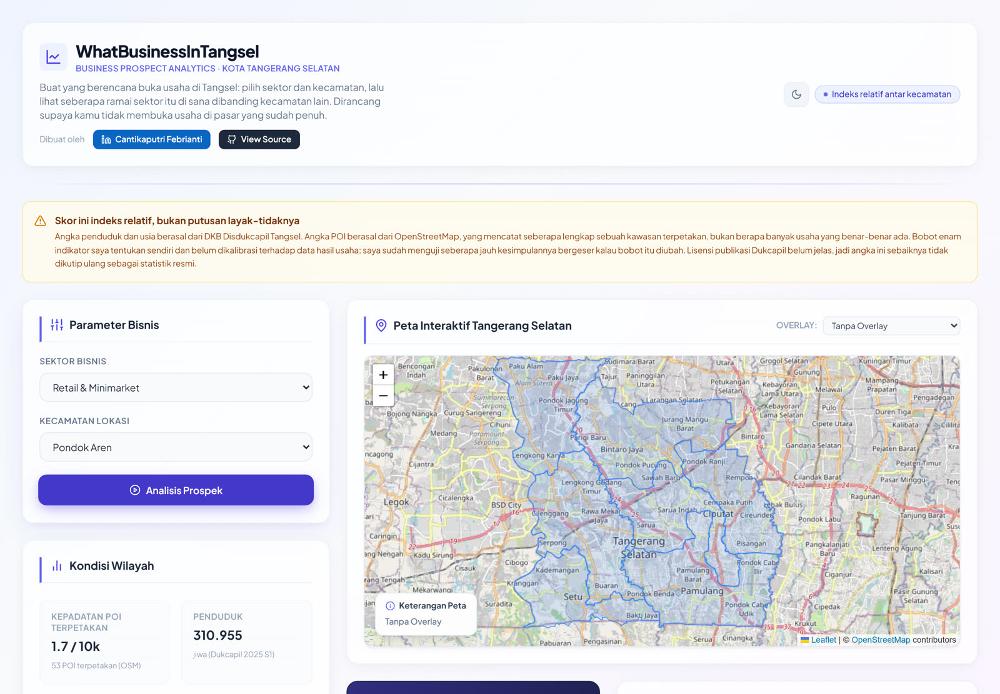

# 🗺️ WhatBusinessInTangsel

> **Business Prospect Analytics Dashboard (prototipe konsep)** — Studi kasus perancangan analisis lokasi usaha di Kota Tangerang Selatan.
>
> ⚠️ **Status data: terverifikasi untuk 6 indikator.** Seluruh angka berasal dari DKB Disdukcapil Kota Tangerang Selatan dan ekstraksi OpenStreetMap (ODbL) yang dapat dijalankan ulang, dengan hash berkas mentah tercatat di [`docs/gate1/source_manifest.json`](docs/gate1/source_manifest.json). Skor tetap merupakan **indeks relatif eksploratif** — bukan penilaian kelayakan usaha, proyeksi keuntungan, atau rekomendasi investasi. Lihat [`docs/gate1/ledger.md`](docs/gate1/ledger.md).



[](https://whatbusinessintangsel.netlify.app/)
[](https://www.linkedin.com/in/cantikaputri-febrianti/)
[](https://nextjs.org/)

---

## 📌 Tentang Proyek

**WhatBusinessInTangsel** adalah portofolio *Business Intelligence* interaktif yang membantu calon pengusaha dan analis untuk:

- 📍 **Membandingkan kecamatan** di Tangerang Selatan memakai satu kerangka skor yang eksplisit
- 📊 **Membandingkan potensi bisnis** antar wilayah secara visual
- 🧮 **Mendapatkan indeks prospek terbobot** dari 6 indikator bersumber pada 3 sektor terverifikasi
- 🗺️ **Mengeksplorasi peta choropleth interaktif** dengan overlay data demografis dan kompetitor

Proyek ini dibangun sebagai **portofolio Business Analyst** untuk mendemonstrasikan perancangan metrik, pemodelan multi-kriteria, analisis spasial, dan penyajian keputusan. Kekuatan yang ditunjukkan adalah *kerangka berpikirnya*, bukan ketepatan angka inputnya — dan justru karena itu batas serta asumsi datanya didokumentasikan terbuka.

---

## ✨ Fitur Utama

| Fitur | Deskripsi |
|-------|-----------|
| 🗺️ **Peta Interaktif** | Choropleth map berbasis Leaflet.js dengan klik-untuk-analisis per kecamatan |
| ⚖️ **Figure Metode** | Timbangan isometrik interaktif: tiap balok = satu indikator setinggi bobot × nilai, pembaca geser di lengan = skor yang sama. 21 kasus (7 kecamatan × 3 sektor) dirender di build time |
| 🧮 **Scoring Engine** | *Weighted scoring* 6 indikator bersumber — kepadatan, populasi, usia 15–34, usia 15–64, kepadatan POI terpetakan, anchor POI |
| 📊 **Visualisasi Multi-Chart** | Radar 6 indikator, bar chart kepadatan POI terpetakan, pie chart 3 sektor |
| ⚖️ **Perbandingan Wilayah** | Tambahkan hingga 3 kecamatan ke mode side-by-side comparison |
| 🌙 **Dark Mode** | Toggle tema gelap/terang dengan persistensi localStorage |
| 🔗 **Sumber Bisa Diklik** | Tiap angka di UI menunjuk ke dokumen aslinya: DKB Dukcapil (PDF), Overpass Turbo, lisensi ODbL, relasi OSM batas kecamatan |
| 📥 **Ekspor Data** | Unduh CSV populasi & luas per kecamatan (Disdukcapil, terverifikasi) |
| 📱 **Responsive Design** | Berfungsi optimal di desktop, tablet, dan mobile |

### Direct link ke sumber

Semua tautan di bawah sudah dicek merespons 200 sebelum dipasang di UI.

| Data | Tautan |
|---|---|
| Populasi & struktur usia | [DKB Semester I 2025 (PDF)](https://disdukcapil.tangerangselatankota.go.id/uploads/demografi/KESELURUHAN1764555784678.pdf) |
| Luas wilayah | [DKB Semester II 2023 (PDF)](https://disdukcapil.tangerangselatankota.go.id/uploads/demografi/KESELURUHAN1706581708476.pdf) |
| POI per kecamatan | [Overpass Turbo](https://overpass-turbo.eu/) — lisensi [ODbL 1.0](https://opendatacommons.org/licenses/odbl/1-0/) |
| Batas kecamatan | [Relasi OSM Ciputat](https://www.openstreetmap.org/relation/10989408) (7 relasi, lihat `docs/gate1/osm_boundaries_meta.json`) |

Catatan: server Dukcapil membalas **403** untuk `curl` tanpa User-Agent + referer, tapi normal
terbuka di browser. Jangan simpulkan tautannya mati hanya dari `curl` polos.

---

## 🧠 Metodologi & Data

**Studi kasus lengkapnya** — masalah, pengguna, scope, pembersihan data, tiga temuan yang
dihitung dari dataset, trade-off, dan keterbatasan — ada di [`docs/CASE_STUDY.md`](docs/CASE_STUDY.md).

### Status & Sumber Data

**Tidak ada indikator yang boleh disebut resmi sampai lolos Gate 1** pada
[`docs/PUBLICATION_PLAN.md`](docs/PUBLICATION_PLAN.md). Tabel di bawah mencatat *sumber yang
dituju* dan tingkat kepercayaan yang jujur, bukan bukti akuisisi.

| Indikator | Sumber | Status |
|------|--------|--------|
| Populasi per kecamatan | DKB Disdukcapil Kota Tangerang Selatan, Semester I 2025 | **Terverifikasi** — PDF mentah + SHA-256 di `docs/gate1/raw/` & `source_manifest.json` |
| Luas wilayah | DKB Semester II 2023 (satu-satunya rilis yang memuat tabel luas) | **Terverifikasi** — dipinjam lintas periode, limitasi tercatat |
| Kepadatan penduduk | Turunan: populasi 2025 ÷ luas 2023 | **Turunan** — angka kepadatan terbitan tidak dipakai (lihat catatan di bawah) |
| Struktur usia 15–34 & 15–64 | DKB Semester I 2025, 77 kelompok usia | **Terverifikasi** — rekonsiliasi aritmetika 100 % |
| Kepadatan POI terpetakan (retail/health/education) | OpenStreetMap via Overpass API, lisensi ODbL | **Terverifikasi, dengan bias terukur** — snapshot & tag terkunci |
| Anchor POI (stasiun/terminal/mall) | OpenStreetMap via Overpass API | **Terverifikasi** |
| Batas administrasi | OSM `admin_level=6`, ODbL | **Terverifikasi** — deviasi luas +0,61 % vs Dukcapil |
| Skor aksesibilitas, daya beli, biaya sewa, tren historis | — | **Dibuang** dari model (tidak ada sumber maupun metode) |

**Temuan yang wajib dibaca:** tabel kepadatan terbitan DKB 2025 S1 tidak konsisten dengan
populasi/luas terbitannya sendiri (total terbit 8.581 jiwa/km² vs hitung 8.943). Dashboard memakai
hasil hitung, bukan angka terbitan.

**Batas interpretasi POI:** jumlah POI OpenStreetMap mengukur kelengkapan pemetaan sukarela, bukan
sensus seluruh usaha. Diukur terhadap ground truth 298 kafe (Google Maps) pada proyek terpisah,
biasnya **tidak seragam**: 1,25× (Ciputat) sampai 5,75× (Ciputat Timur), bahkan terbalik di Setu
(0,40×). Karena itu label UI dikunci menjadi **"kepadatan POI terpetakan"**, bukan "jumlah
kompetitor", dan metrik per 10.000 jiwa dipakai sebagai ukuran utama.

Data konsep lama tidak dihapus — diarsipkan di `docs/gate1/concept_data_archive/` sebagai jejak
audit, dan tidak lagi dibaca oleh aplikasi.

### Weighted Scoring Formula

Enam indikator dinormalisasi ke 0–1 dengan **pembagi yang diturunkan dari data** (nilai maksimum
nyata antar kecamatan), bukan angka yang diasumsikan. Hasilnya digabung dengan bobot di bawah,
dikali 10, dan dibatasi ke 1.0–10.0.

```
Skor Indeks = (
  (Kepadatan Penduduk        × 0.20) +   normalizer: 11.797 jiwa/km² (Pamulang)
  (Total Populasi            × 0.20) +   normalizer: 339.054 jiwa (Pamulang)
  (Usia 15–34 tahun          × 0.15) +   normalizer: 32,97 % (Serpong Utara)
  (Usia 15–64 tahun          × 0.15) +   normalizer: 74,33 % (Serpong Utara)
  (Peluang Pasar / POI rendah × 0.15) +  normalizer per sektor: retail 4,97 / health 1,39 / education 7,51 per 10k
  (Anchor POI                × 0.15)     normalizer: 8 simpul (Pondok Aren)
) × 10  →  dibatasi pada rentang 1.0–10.0
```

Bobot dijumlah tepat 1,00 dan dipatok di satu tempat (`SCORE_WEIGHTS` pada
`src/lib/engine/scoring.ts`); label ambang (3,0 / 5,0 / 6,5 / 8,0) juga satu sumber
(`labelForScore`) yang dipakai ulang oleh `recommender.ts` — sebelumnya dua tabel ambang terpisah
menyebabkan divergensi di pita 5,0–5,4.

Keputusan bobot masih **penilaian perancang, bukan hasil kalibrasi**. Sensitivitasnya sudah diuji
(`docs/gate3/SENSITIVITY.md`): juara tahan terhadap revisi bobot sampai ~10 poin persen, label
kategoris rapuh (37,5–43,9 % sel-bobot berubah), dan W3/W4 nyaris tidak berfungsi sebagai pembeda
karena S3 hanya menempati rentang 0,9205–1,0000 dan S4 0,9556–1,0000. Yang tidak bisa dilakukan
tanpa data hasil usaha adalah **kalibrasi**, bukan pengujian sensitivitas.

---

## 🏗️ Tech Stack

```
Frontend   : Next.js 14 (App Router) + TypeScript + React
Peta       : Leaflet.js + React-Leaflet
Charts     : Chart.js + React Chart.js 2
Figure     : Kit isometrik vendor (src/lib/iso/) — geometri dihitung di build time, tanpa runtime chart lib
Icons      : Lucide React
Styling    : Tailwind CSS
Deploy     : Netlify (runtime plugin dikonfigurasi di sisi Netlify, tidak ada di package.json)
Data       : docs/gate2/verified_dataset.json — dibangun oleh npm run data:build (11 QC)
```

---

## 🚀 Menjalankan Secara Lokal

```bash
# Clone repository
git clone https://github.com/cantikapf/WhatBusinessInTangsel.git
cd WhatBusinessInTangsel

# Install dependencies
npm install

# Jalankan development server
npm run dev
```

Buka [http://localhost:3000](http://localhost:3000) di browser.

### Perintah Verifikasi

```bash
npm run lint        # ESLint (next/core-web-vitals)
npm test            # engine (15 kasus) + UI render suite (8 subtest)
npm run data:build  # rantai data: derive + fetch cache + 11 QC + emit dataset
npm run data:qc     # uji bahwa QC benar-benar menggigit (4 mutasi + kontrol)
npm run build       # type check + static build
```

### Gate 4 — QA

Pemeriksaan kualitas sistematis untuk memverifikasi fungsionalitas UI, engine perhitungan, dan integritas dataset kanonik:

| Perintah | Verifikasi & Bukti |
|----------|-------------------|
| `npx next lint` | ESLint (Next.js core-web-vitals) bersih tanpa kesalahan |
| `node test-engine.js` | Matriks 21/21 kombinasi sektor × kecamatan pada scoring & recommender engine |
| `npm test` | UI subtests: render SSR throw-free, reaktivitas komponen, kontrak error statis |
| `npm run data:build` | Pipeline data reproducible: 11 uji kontrol kualitas (QC) & emisi dataset kanonik |
| `npm run data:qc` | Uji resistensi validasi QC (4 mutasi sengaja digagalkan + kontrol lolos) |
| `npm run build` | Pemeriksaan tipe TypeScript (`tsc --noEmit`) dan Next.js production build statis |
| `node tests/browser/qa.js` | Browser QA 43/43: desktop + mobile, keyboard, dark mode, peta, chart, comparison, unduhan, figure metode, 0 console error. Butuh playwright di direktori terpisah + `npx next start -p 3111` |

---

## 📂 Struktur Proyek

```
WhatBusinessInTangsel/
├── src/
│   ├── app/
│   │   └── page.tsx          # Main dashboard page
│   ├── components/
│   │   ├── FilterForm.tsx     # Sektor & kecamatan selector
│   │   ├── MapComponent.tsx   # Leaflet choropleth map
│   │   ├── AnalyticsPanel.tsx # Score results & recommendations
│   │   ├── ChartsPanel.tsx    # Radar, bar, pie charts
│   │   ├── ComparisonPanel.tsx# Side-by-side comparison table
│   │   ├── MethodPanel.tsx    # Metodologi, komposisi bobot & sumber data
│   │   ├── method-figure/     # Figure timbangan: model, geometri, komponen live
│   │   ├── DataNotice.tsx     # Banner disclaimer data bersumber
│   │   └── Footer.tsx         # Metodologi & author info
│   ├── lib/
│   │   ├── engine/
│   │   │   ├── scoring.ts     # Weighted scoring algorithm
│   │   │   └── recommender.ts # Recommendation generator
│   │   └── iso/               # Kit isometrik (vendored dari skill anatomy, bukan dependency)
│   └── data/
│       ├── verifiedDataset.ts # Bridge bertipe ke dataset kanonik
│       └── geojson/           # Batas kecamatan (layer lama, dipertahankan untuk peta)
├── public/
│   └── dataset_penduduk_tangsel.csv  # Sumber tombol unduh di footer
├── tests/
│   └── ui.test.js             # SSR render suite
├── test-engine.js             # Uji scoring & recommender
├── HERMES.md                  # SOP agen & gerbang verifikasi
├── PROJECT.md                 # Status, backlog, gotchas
├── IDEA.md                    # Ringkasan arsitektur
├── docs/
│   ├── gate1/                 # Bukti: PDF mentah, hash, ledger, keputusan scope
│   ├── gate2/                 # Pipeline reproducible: build.js, QC, dataset kanonik
│   └── dashboard-preview.jpg
└── netlify.toml
```

---

## 👤 Author

**Cantikaputri Febrianti** — Business Analyst

Proyek ini menampilkan kemampuan dalam:
- **Perancangan metrik** — menerjemahkan pertanyaan bisnis menjadi 6 indikator yang dapat dihitung, lengkap dengan batas interpretasinya
- **Spatial Analysis** — choropleth berbasis GeoJSON, 7 lapisan overlay metrik
- **Business Intelligence** — model skor multi-kriteria, komparasi antar wilayah, aturan rekomendasi
- **Data Quality Discipline** — dokumentasi provenance, pemisahan asumsi dari fakta, dan gate sebelum klaim dipublikasikan
- **Full-Stack Development** — Next.js 14, TypeScript, Leaflet, Chart.js

Akuisisi data (Disdukcapil & Overpass) sudah dijalankan dan dapat direproduksi: berkas mentah,
hash, skrip ekstraksi, dan QC tersimpan di `docs/gate1/` dan `docs/gate2/`. Yang masih terbuka
adalah lisensi publikasi Dukcapil, audiensi batas OSM terhadap BIG, dan kalibrasi bobot.

[](https://www.linkedin.com/in/cantikaputri-febrianti/)

---

*Sumber: DKB Disdukcapil Kota Tangerang Selatan & OpenStreetMap (ODbL). Peta dasar © OpenStreetMap contributors. © 2026 Cantikaputri Febrianti*
